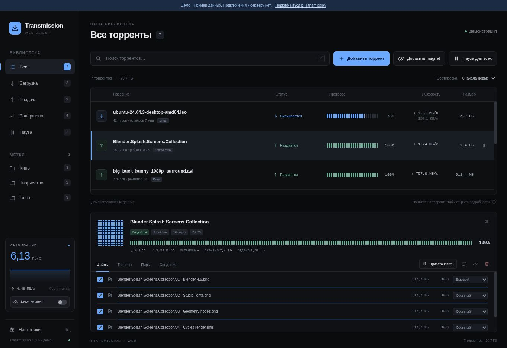
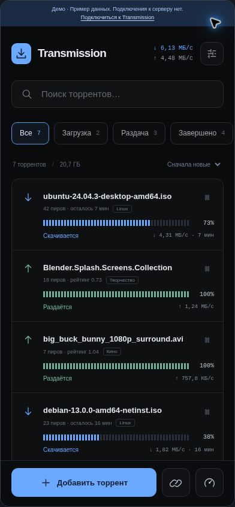

# Transmission Theme

Тёмный веб-интерфейс Transmission: почти чёрный фон, голубые акценты, сегментированные индикаторы прогресса и отдельная мобильная компоновка.

Самостоятельная замена штатного web UI через `TRANSMISSION_WEB_HOME`. Без npm-зависимостей, внешних шрифтов, CDN и отдельного backend. На сервере нужны только статические файлы и работающий Transmission.



<details>
<summary>Мобильный интерфейс</summary>



</details>

## Возможности

- Адаптивная таблица на компьютере и карточки с нижней панелью действий на телефоне.
- Поиск, сортировка, фильтры состояния, фильтрация по существующим меткам Transmission.
- Добавление нескольких `.torrent`-файлов, drag & drop, magnet и HTTP(S)-ссылки.
- Выбор папки на сервере и добавление сразу на паузе.
- Запуск, пауза, пауза для всех активных торрентов, перепроверка и обновление трекеров.
- Подробности: файлы, выбор скачиваемых файлов, приоритеты, трекеры, пиры и сведения.
- Карта реально полученных частей, общий график скорости, скачивание и отдача.
- Обычные и альтернативные лимиты скорости, папка по умолчанию, частота обновления.
- Удаление торрента с отдельным подтверждением; удаление данных с диска по умолчанию **выключено**.
- Обработка CSRF-сессии Transmission, ошибок авторизации, потери связи и таймаутов.
- Клавиатура: `/` — поиск, `⌘/Ctrl + ,` — настройки, `Esc` — закрыть подробности. Вкладки поддерживают стрелки, Home и End.

Метки отображаются из RPC; создавать и редактировать их в этой версии нельзя. Интерфейс на русском языке. Это независимый проект, не официальный клиент Transmission.

## Быстро посмотреть

Нужен **Node.js 22+**. Устанавливать npm-пакеты не требуется.

```bash
git clone https://github.com/mrdaark/transmission-theme.git
cd transmission-theme
npm run dev
```

Откройте **http://localhost:3000/?demo=1**. Для проверки разных мобильных размеров: **http://localhost:3000/scripts/mobile-preview.html**.

Демо включается только явно через `?demo=1`, работает в памяти браузера и не обращается к Transmission. Пауза, запуск, удаление и приоритеты меняют только пример данных. Добавление реального торрента в демо запрещено. Обновление страницы сбрасывает демонстрацию.

Без `?demo=1` интерфейс подключается к настоящему RPC; при отсутствии сервера показывает ошибку, а не подставляет пример данных. Сервер разработки предназначен только для просмотра файлов, RPC он не проксирует.

## Установка

### 1. Подготовить статические файлы

```bash
npm run build
```

Готовый интерфейс находится в **`dist/`**. Node.js нужен только для подготовки; для работы установленной темы он не требуется.

Альтернатива без локальной сборки: откройте успешный запуск **CI** во вкладке **Actions** и скачайте артефакт **`transmission-web`**. Распакуйте его в отдельную папку: в её корне должны находиться `index.html`, `app.js`, `style.css`, `lib/` и `assets/`.

### 2. Указать Transmission папку интерфейса

Пример для **существующего** Docker Compose сервиса:

```yaml
services:
  transmission:
    # Сохраните свой image, environment, ports, networks и остальные volumes.
    environment:
      TRANSMISSION_WEB_HOME: /theme
    volumes:
      - ./transmission-theme/dist:/theme:ro
```

Путь слева должен указывать на **вашу** папку `dist`. Добавьте переменную и mount к существующим настройкам, затем пересоздайте контейнер:

```bash
docker compose up -d transmission
```

Откройте привычный адрес, обычно **`http://адрес-сервера:9091/transmission/web/`**. Если видна старая тема, выполните полное обновление страницы или очистите её кеш.

Образ контейнера должен позволять переопределять `TRANSMISSION_WEB_HOME`. Если entrypoint образа задаёт эту переменную повторно, настройте собственный web UI предусмотренным этим образом способом. Расположенный внутри контейнера `index.html` должен быть доступен на чтение пользователю Transmission.

Без Docker задайте `TRANSMISSION_WEB_HOME=/абсолютный/путь/к/dist` в окружении службы `transmission-daemon` и перезапустите службу. В systemd это можно сделать drop-in-файлом:

```ini
[Service]
Environment=TRANSMISSION_WEB_HOME=/opt/transmission-theme/dist
```

Для возврата штатного web UI уберите переопределение `TRANSMISSION_WEB_HOME` и перезапустите daemon / пересоздайте контейнер.

## Совместимость и подключение

Целевая совместимость: **Transmission 3.00 и 4.x**, через классический RPC (`torrent-get`, `session-get` и другие методы). [Спецификация Transmission 4.0.6](https://github.com/transmission/transmission/blob/4.0.6/docs/rpc-spec.md). В Transmission 4.1 этот протокол пока поддерживается, но объявлен устаревшим; JSON-RPC 2.0 этой темой пока не используется. Совместимость с будущим Transmission 5 не заявляется.

Современный браузер с ES modules, `fetch`, `<dialog>` и `inert`: Chrome/Edge, Firefox или Safari 16+. Мобильная компоновка включается при ширине до 900 px.

RPC и тема должны быть доступны с **одного origin** — одинаковые протокол, хост и порт. По умолчанию при размещении в `/transmission/web/` запросы идут в `/transmission/rpc`. Для `/seedbox/transmission/web/` автоматически используется `/seedbox/transmission/rpc`.

В **Настройки → Путь к RPC** можно задать другой абсолютный путь на этом сервере. При смене RPC сохраняются только локальные предпочтения подключения: лимиты старого daemon не отправляются новому. Дождитесь подключения, затем откройте настройки снова, если хотите изменить настройки сервера.

Авторизация остаётся штатной HTTP Basic / авторизацией вашего reverse proxy. Тема не запрашивает и не хранит пароли. `401` требует входа через обычный адрес веб-интерфейса. `403` означает, что нужно проверить whitelist/host whitelist и proxy. При `409` клиент получает `X-Transmission-Session-Id` и повторяет запрос с токеном; proxy должен пропускать этот заголовок в обе стороны. Отключать защиту RPC для установки темы не нужно.

Настройки интерфейса (RPC-путь, сортировка, интервал обновления) сохраняются в `localStorage`. При закрытом/скрытом табе регулярный опрос останавливается. После возвращения или восстановления сети данные обновляются. При ошибке показанные ранее данные явно отмечаются как устаревшие, действия блокируются. Автоматически повторяются только опрос и CSRF-согласование; мутации при сетевой ошибке не повторяются, так как сервер уже мог их выполнить.

## Разработка и проверка

```bash
npm run check
npm test
npm run build
```

Тесты проверяют CSRF, ротацию токена, ошибки RPC/HTTP, таймауты без повтора удаления, статусы/фильтры, форматирование, экранирование HTML, same-origin RPC-путь, ссылки и изоляцию демо. CI выполняет эти проверки и сохраняет установочный артефакт.

В браузере проверены настольный вид и мобильный iframe, поиск, подробности, вкладки, приоритет файлов и формы на демоданных. **Проверка на вашем работающем daemon ещё не проводилась.** Скриншоты показывают демонстрацию; доступ к вашему серверу для их создания не использовался.

Код: `app.js` — интерфейс и жизненный цикл опроса; `lib/rpc.js` — RPC-транспорт; `lib/model.js` — чистые функции; `lib/demo.js` — изолированная демонстрация; `style.css` — оформление. `scripts/build.mjs` копирует в `dist/` только файлы веб-клиента. Сервер разработки, тесты, документация и Git-данные в установленную тему не попадают.

Лицензия: [MIT](LICENSE).
